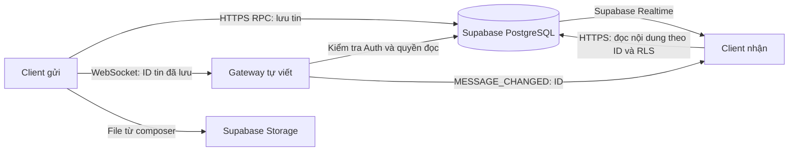

# Đánh giá chức năng lập trình mạng — 15/10/2026

Phạm vi: đọc code hiện tại trong working tree, lần theo đường gọi từ giao diện đến transport/backend và chạy lại các kiểm thử mạng local. Đây là đánh giá hiện trạng, không triển khai tính năng, không thay đổi cloud/VPS. Chưa có đề cương hoặc tiêu chí chấm của giảng viên nên các phần mở rộng không được coi mặc nhiên là yêu cầu bắt buộc.

## Kết luận

Đồ án có phần lập trình mạng tự viết đáng kể: gateway WebSocket trên socket Node.js, HTTP Upgrade, codec frame, giao thức ứng dụng, phòng chat, phiên xác thực, heartbeat, giới hạn tài nguyên và truyền file chia khối có ACK/SHA-256. Các phần này có kiểm thử chạy qua socket thật.

Tuy nhiên, giao diện đang dùng kiến trúc kết hợp Supabase và gateway. Tin nhắn được lưu bằng Supabase RPC trước; gateway chỉ xác minh rồi phát ID thay đổi. Giao diện đồng thời nghe Supabase Realtime. File đính kèm từ composer đi qua Supabase Storage. Typing, presence theo socket và truyền file qua gateway chưa được nối trọn vẹn vào giao diện.

Vì vậy, có thể trình bày đây là ứng dụng chat dùng dịch vụ backend kết hợp gateway mạng tự xây dựng. Chưa đủ bằng chứng để trình bày toàn bộ luồng chat/file hiện tại là chạy độc lập qua server socket tự viết.

## Luồng thực tế

Gateway còn có luồng file riêng: FILE_START → FILE_CHUNK/FILE_ACK → FILE_COMPLETE/FILE_READY → HTTP download có quyền truy cập. Luồng này được frontend adapter và integration test sử dụng, chưa được composer sử dụng.

## Đã có và mức độ hoàn thiện

| Hạng mục mạng | Hiện trạng | Bằng chứng chính |
| --- | --- | --- |
| Mô hình client/server nhiều kết nối | Server quản lý connections, rooms và tập client trong từng phòng; giới hạn số kết nối cấu hình được | gateway/src/server.ts:36–47, 100, 128–140 |
| HTTP Upgrade sang WebSocket | Tự tạo phản hồi 101 và Sec-WebSocket-Accept; server đọc/ghi socket sau upgrade | gateway/src/websocket-codec.ts:30–49; gateway/src/server.ts:55–63 |
| Đóng gói và phân tích frame | Mask/unmask, độ dài payload, giữ phần buffer chưa đủ; encode text/control frame; giới hạn payload | gateway/src/websocket-codec.ts:55–173 |
| Giao thức ứng dụng | Protocol 2.0 có HELLO/WELCOME, JOIN/LEAVE, thông báo thay đổi tin, ACK, typing/presence và file | gateway/src/protocol.ts |
| Chat trực tiếp/nhóm và đồng bộ thay đổi | Giao diện có luồng lưu tin, sửa/thu hồi và nghe sự kiện; gateway phát thông báo theo phòng sau khi xác minh dữ liệu đã lưu | src/context/ChatFlowContext.tsx:175–224, 256–323; gateway/src/server.ts:103–111 |
| Xác thực và phân quyền mạng | Auth xác minh bearer; kiểm tra membership lúc join/thao tác/gửi đến người nhận; timeout; hết hạn phiên; đổi token cùng user | gateway/src/supabase-authorizer.ts; gateway/src/server.ts:77–99, 128–140 |
| Heartbeat và kết nối lại | Server PING/PONG, đóng kết nối chết; client tự reconnect 3 giây và join lại sau WELCOME | gateway/src/server.ts:158; src/services/gateway-client.ts:27–71 |
| Bù tin bị bỏ lỡ | Đọc lại tin đã tải và lấy tin mới theo cursor khi subscription hoạt động lại, online hoặc tab được mở lại | src/context/ChatFlowContext.tsx:187–224 |
| Truyền file tự viết | Khối 32 KiB, gửi tuần tự chờ ACK, kiểm tra thứ tự/kích thước/digest; HTTP download có capability và kiểm tra phiên/quyền | src/services/gateway-client.ts:90–113; gateway/src/file-transfers.ts; gateway/src/server.ts:114–126, 142–153 |
| Kiểm soát tài nguyên | Rate limit, hàng đợi mỗi socket, giới hạn frame, timeout authorizer, xử lý client nhận chậm, quota file và upload | gateway/src/server.ts:32–75; gateway/src/file-transfers.ts:21, 73–107 |
| Trạng thái đọc tin | Có mark_conversation_read và suy ra read từ metadata trong DB; độc lập với MSG_ACK của gateway | src/context/ChatFlowContext.tsx:238; src/services/messages.ts:40–42 |

Socket server ở đây dùng TCP do Node.js cung cấp. Browser dùng WebSocket API gốc. TCP đảm nhiệm truyền tin tin cậy ở tầng vận chuyển; đồ án tự xử lý framing và giao thức ứng dụng phía trên, không tự cài đặt TCP stack.

## Có code nhưng chưa hoàn thiện thành chức năng người dùng

1. **Typing:** gateway nhận/phát TYPING và client có sendTyping/onTyping, nhưng không thấy call site trong giao diện để gửi lúc nhập hoặc hiển thị sự kiện nhận được. Test gateway có kiểm tra membership và lọc người bị chặn.
2. **Presence theo kết nối:** gateway phát trạng thái và tự phát offline khi socket cuối của user mất. Client có setPresence/onPresence nhưng app chưa dùng các API đó. UI đọc presence từ dữ liệu profile qua list_profiles; chưa thể coi đó là trạng thái sống của socket.
3. **File qua gateway:** uploadFileChunked/getFileDownloadUrl có implementation và integration test. Composer gọi uploadFile → uploadAttachment → Supabase Storage. Chưa có thao tác UI để gửi/nhận file bằng transport gateway hoặc lưu file gateway thành attachment trong lịch sử chat.
4. **Trạng thái kết nối:** UI “Connected · Live messages” dựa trên subscription Supabase, không dựa trên gatewayClient.onStatus. Nếu muốn demo gateway, cần quan sát riêng kết nối này.
5. **Ý nghĩa ACK:** MSG_ACK xác nhận gateway đã kiểm tra được tin/tác vụ đã lưu. Nó được gửi trước roomDelivery; không xác nhận mọi client nhận được hoặc người nhận đã đọc. App chưa đăng ký onMsgAck để làm một luồng xác nhận giao tin riêng.

Bằng chứng call site: src/services/gateway-client.ts:80–118; src/context/ChatFlowContext.tsx:156–166, 212–224, 266–274, 332; src/services/storage.ts:10–23; src/services/workspace.ts:19–47; src/components/chat/ChatRoom.tsx:54–61.

## Chưa có hoặc chưa có bằng chứng

| Hạng mục | Đánh giá |
| --- | --- |
| Server chat độc lập Supabase | Chưa có: lưu tin, xác thực và kiểm tra quyền còn dựa vào Supabase. Mất dịch vụ này thì gateway hiện tại không thay thế được backend |
| WebSocket hỗ trợ đầy đủ mọi dạng frame | Chưa có: server chủ động từ chối non-FIN, continuation và BINARY. Codec có xử lý buffer TCP thiếu dữ liệu, nhưng đó không phải hỗ trợ fragmented WebSocket message |
| File bằng binary WebSocket frame | Chưa có: bytes được Base64 trong JSON text frame. Chia file ở tầng ứng dụng vẫn đã làm |
| Tiếp tục upload sau mất kết nối | Chưa có giao thức resume. Có ACK và nhận lại chunk trùng giống nhau ở server, nhưng client không tự thương lượng tiếp tục; draft bị dọn sau disconnect |
| Reconnect nâng cao / hàng đợi gửi offline | Có reconnect cố định 3 giây và bù lịch sử từ DB; chưa thấy exponential backoff/jitter, durable outbox hay tự phát lại thông báo gateway có ACK sau lỗi |
| Nhiều gateway và failover | Chưa có broker/shared state cho room/session; các Map nằm trong một process. File hoàn tất có manifest trên disk, nhưng điều đó không tạo thành cluster |
| Gọi thoại/video | Chưa có: các nút đang disabled; không thấy implementation WebRTC trong source hiện tại |
| UDP/P2P/multicast | Không thấy implementation. Chỉ cần bổ sung nếu đề cương yêu cầu hoặc chủ động mở rộng |
| TLS/WSS triển khai thực tế | Client hỗ trợ URL wss và runbook yêu cầu TLS ở phía trước gateway. Server code tạo HTTP server; chưa kiểm tra reverse proxy, chứng chỉ và endpoint protocol 2.0 đang chạy trên VPS |
| Kiểm thử nhiều máy và lỗi mạng thật | Chưa chạy lại bản mới giữa hai browser/máy với Supabase/VPS thật; chưa có bằng chứng đo packet capture, latency/throughput hoặc mô phỏng mạng chậm/mất kết nối có hệ thống |
| Khả năng chịu tải | Có cấu hình maxConnections=1000, không có kết quả chứng minh 1000 client. Chưa có benchmark kết nối đồng thời/độ trễ/tài nguyên |

Các mục thiếu ở trên có mức ưu tiên khác nhau; không cần làm tất cả để một đồ án chat mạng đạt mục tiêu. Đặc biệt thoại/video, UDP và cluster không tự động là yêu cầu của đề tài này.

## Kiểm chứng trong lượt đánh giá này

- `npm --prefix gateway test`: **29/29 pass**, không skip. Bao gồm socket/HTTP thật, quyền vào phòng, xử lý lỗi peer, rate limit, phiên hết hạn, typing/presence và upload/download/quota.
- `npm run test:local`: **1/1 pass**. Hai GatewayClient thật qua TCP local: thông báo gửi/sửa/thu hồi từ dữ liệu đã lưu giả lập, upload/download so sánh byte, thu hồi membership, refresh token và disconnect.
- Test hai adapter dùng **authorizer và committed rows trong bộ nhớ**, không kết nối Supabase thật. Test provider riêng dùng fetch giả lập. Vì vậy không suy diễn hai kết quả này thành kiểm thử toàn hệ thống cloud.
- Không chạy live cloud scripts, không đổi migration, không deploy VPS và không tạo tài khoản thật trong lượt này.
- Các kết quả frontend/SQL/package của lượt trước được giữ trong docs/VERIFICATION.md và tasks/cleanup.md; không coi là vừa chạy lại toàn bộ trong lượt đánh giá mạng.

## Ưu tiên phù hợp đồ án mạng

1. **Hoàn thiện phần đã có:** nối typing và presence theo socket vào UI; hiển thị riêng trạng thái gateway; nối file chia khối vào một luồng người dùng rõ ràng và xử lý lưu metadata/quyền tải tương ứng. Xác định gateway đóng vai trò thông báo hay là đường gửi tin chính rồi thống nhất tài liệu/demo theo lựa chọn đó.
2. **Chứng minh trên môi trường thật:** kiểm tra và triển khai đồng bộ schema/client/gateway protocol 2.0 vào staging; thử hai máy hoặc hai phiên browser, nhiều phòng, join/leave, refresh token, mất mạng/kết nối lại, file nhiều khối và người không có quyền. Ghi log, luồng gói tin đã che token, thời gian và kết quả.
3. **Đo và xử lý lỗi mạng:** bổ sung đo RTT/độ trễ giao tin/thông lượng file, test nhiều client và peer chậm, reconnect backoff/jitter; cân nhắc resume file nếu thời gian cho phép. Không ghi số lượng client hỗ trợ khi chưa đo.
4. **Chỉ mở rộng sau khi đối chiếu rubric:** WebRTC voice/video, UDP/P2P hoặc nhiều gateway. Các phần này không thay thế bằng chứng cho chat và truyền file đang là lõi của đề tài.

## Liên hệ với cleanup đang chờ commit

Gateway, codec, protocol và luồng file chia khối được giữ lại dù chưa được composer gọi, vì có implementation/test và thuộc mục tiêu đồ án. Script test-live-gateway-chat.mjs bị bỏ là script protocol cũ: HELLO thiếu version, ID mẫu không đúng UUID, tự ký token và đợi tên packet cũ. Việc bỏ script này không đồng nghĩa đã có bài demo live mới; cần bổ sung kịch bản staging protocol 2.0 khi triển khai. Chi tiết tại tasks/cleanup.md.
