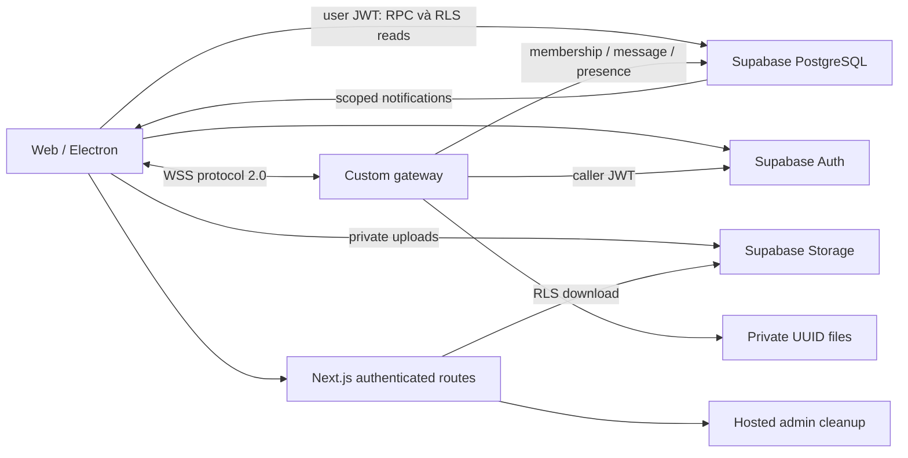

# Kiến trúc ChatFlow sau remediation

Tài liệu đối chiếu source ngày 15/10/2026. Mô tả implementation local, không chứng nhận gateway/cloud đang chạy bản mới. Contract ở [API.md](API.md), kết quả ở [VERIFICATION.md](VERIFICATION.md).

## Thành phần và nguồn dữ liệu chuẩn

Next.js 16.3.6/React 19.3.0 cung cấp UI, cookie session, Auth callback và HTTP tải file/thao tác tài khoản. Electron đóng gói standalone Next.js và mở origin loopback riêng. Supabase Auth xác minh identity; PostgreSQL/RPC/RLS quyết định membership, ownership và nội dung message. Supabase Storage chứa attachment/avatar của UI. Supabase Realtime và gateway RFC 6455 thông báo thay đổi.

Gateway production gọi Auth xác minh token rồi đối chiếu subject/expiry; request database dùng JWT người dùng và public project key. Shared HS256 helper chỉ còn phục vụ test. Production thiếu provider sẽ không khởi động.

## Gửi, sửa, thu hồi

1. UI tạo optimistic row với client request UUID ổn định; send_message commit transaction, kiểm tra membership và attachment bytes/metadata.
2. Sau SQL success, client gửi notification gateway bằng persisted server ID/client ID. Gateway đọc row dưới RLS, đối chiếu room/author/request/state rồi ACK và phát MESSAGE_CHANGED chỉ chứa ID.
3. Receiver dùng chung queue cho gateway và Supabase Realtime. messagesById lấy state hiện tại dưới RLS; merge theo ID, giữ thứ tự timestamp/ID và refresh metadata. Packet không cung cấp body/author/URL chuẩn.
4. Edit/recall commit bằng RPC trước notification. Row lock và IS DISTINCT FROM từ chối NULL author, sai tác giả và former member. SQL success không chờ gateway ACK.
5. Recall lưu original một lần vào chat_private.message_audit, không cấp đọc browser; BEFORE trigger xóa content/media public atomically. Tombstone còn ID/cursor. Attachment/reaction/Storage chỉ đọc được khi parent live. Latest preview được recompute; edit tin cũ không đổi ordering.

Generation guards loại history/hydration cũ sau clear, đổi conversation hoặc logout. Duplicate notification đọc lại state, không tạo message hay tự cộng unread. Cursor catch-up phục vụ reconnect/mất sự kiện. Thu hồi không xóa được nội dung recipient đã tải về trước đó.

## Ranh giới WebSocket

Codec tự viết giữ mục tiêu đồ án networking: TCP byte stream → RFC 6455 frames → UTF-8 JSON text packets. Client frames phải masked, FIN và đúng opcode; không hỗ trợ fragmented/binary application frames. Control frames có quy tắc riêng. Parser kiểm tra announced length trước allocation; validator kiểm tra direction, shape, UUID, integer, Base64 và field bounds.

Mỗi socket serialize dispatch và bắt rejection. HELLO deadline, auth concurrency, queue/rate limits, expiry, heartbeat và slow-consumer guard giới hạn lỗi trong connection liên quan. Client chỉ CONNECTED sau WELCOME khớp request/subject; token refresh đợi ACK mới, khác subject cần kết nối mới. JOIN, operation và recipient delivery đều recheck membership; provider timeout fail closed.

Phần byte-level phục vụ giải thích đồ án vẫn nằm ở websocket-codec.ts:

| Phần frame | Cách đọc |
| --- | --- |
| Byte 0 | FIN ở bit 7, RSV ở bit 4–6, opcode ở bit 0–3 |
| Byte 1 | MASK ở bit 7, payload length indicator ở 7 bit còn lại |
| Extended length | Indicator 126 đọc UInt16BE; 127 đọc UInt64BE và kiểm tra giới hạn trước khi chuyển sang Number/allocation |
| Mask key | Bốn byte khi MASK=1; client payload phục hồi bằng rawPayload[i] XOR maskKey[i % 4] |
| Payload | JSON UTF-8 trong opcode TEXT; server response không masked |

HTTP Upgrade dùng Base64(SHA1(clientKey + GUID)), với GUID 258EAFA5-E914-47DA-95CA-C5AB0DC85B11. Test vector RFC có key dGhlIHNhbXBsZSBub25jZQ== và accept s3pPLMBiTxaQ9kYGzzhZRbK+xOo=. Đây là handshake framing, không thay thế JWT authentication. PING/PONG giữ liveness; chúng không kéo dài expiry của credential. Base64 chunk là biểu diễn byte file trong JSON, không phải mã hóa bảo mật; TLS/WSS bảo vệ đường truyền.

Presence/typing chỉ đến recipient đã authenticate và còn hạn. can_observe_presence kiểm tra block hai chiều tại delivery; renderer cache không cấp quyền. list_profiles và profile embedding che presence/activity timestamp; raw profile grants không cho đọc hai trường đó.

## Hai luồng file

Composer dùng Supabase: reserve metadata → private Storage upload → send RPC kiểm tra finalized metadata → bind attachment. Discard claim khóa row để serialize với send. Sau leave, uploader được list/claim draft của mình nhưng không được đọc bytes/history. Nếu direct Storage DELETE bị SELECT RLS chặn, hosted endpoint chỉ xóa exact path của claim đã xác minh, rồi user RPC finalize.

Transport gateway riêng: FILE_START với room/digest/size → UUID server cấp → 32 KiB binary chunks mã hóa Base64 trong JSON → mỗi chunk ACK → full digest check → exclusive final file/manifest. Root containment, directory/symlink checks, owner/socket binding, quotas và expiry bảo vệ filesystem. Restart bỏ draft/orphan và nạp completed manifests để giữ quota/authorization. Completed gateway file không tự tạo Supabase attachment.

Download gateway dùng HMAC capability theo file/room/user/socket, tối đa 60 giây và không vượt JWT expiry; HTTP recheck session/membership. Không serve manifest/URL raw. Limit cụ thể ở API.md. Completed files tiêu quota tới khi operator áp dụng retention đã chọn; chưa có scheduled deletion job.

## Desktop và lifecycle tài khoản

Standalone chỉ xuất tám biến cấu hình public trong allowlist. Không copy nguyên .env.local. Electron tự đặt runtime/origin marker và lọc privileged inherited environment trước khi spawn. Secret gate kiểm tra static, standalone, distribution và ASAR, có fixture credential tests.

Web cookie deletion yêu cầu canonical Origin; hosted bearer deletion chỉ dùng subject Auth đã xác minh, không fallback cookies. Desktop xác minh local cookie/access token và forward bearer đến HTTPS endpoint/operator allowlist cấu hình trước. Timeout/redirect/remote failure trả lỗi retry. Admin key chỉ ở hosted server. Claimed draft cleanup dùng cùng identity/origin guards.

Xóa account dọn profile/files và identity; lịch sử đã gửi vẫn còn với sender NULL. UI description và confirmation nói rõ điều này. Storage và Auth không có transaction xuyên dịch vụ; cleanup lỗi dừng trước identity deletion và có thể retry.

## Source và kiểm chứng

| Trách nhiệm | Source | Kiểm chứng local |
| --- | --- | --- |
| SQL ownership/recall/preview/presence/cleanup | supabase/migrations/20261014000000_remediation.sql | PGlite replay và historical upgrade fixture |
| Gateway/session/authority | gateway/src/server.ts, supabase-authorizer.ts, packet-validation.ts, websocket-codec.ts | TCP/WebSocket, provider failure và expiry tests |
| Gateway files | gateway/src/file-transfers.ts | Bytes/digest/owner/quota/restart/capability tests |
| Receiver | src/context/ChatFlowContext.tsx, src/services/messages.ts, workspace.ts | Forged/duplicate/clear/logout regressions |
| Socket adapter | src/services/gateway-client.ts | Lifecycle/upload unit tests và test:local hai adapter thật qua TCP |
| Hosted/desktop mutation | src/lib/account-deletion.ts, API route, electron/main.cjs | Identity/origin/timeout/cleanup route tests |
| Packaging | scripts/prepare-standalone.mjs, check-client-secrets.mjs | Fixture tests, build và packaged secret gate |

PGlite/stub tests không chứng minh hosted Storage HTTP, Realtime, SMTP hoặc thao tác EXE của người dùng. Thứ tự migration/compatibility release theo [DEPLOYMENT.md](DEPLOYMENT.md).
