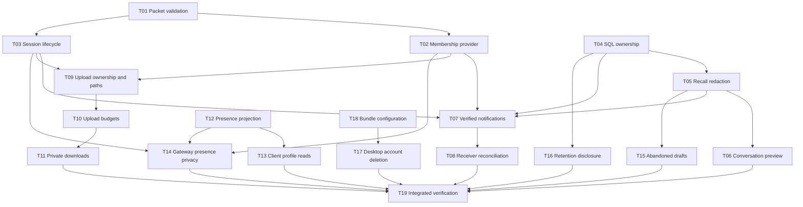

# Kế hoạch sửa ChatFlow sau review 14/10/2026

Trạng thái ngày 15/10/2026: đã triển khai và xác minh local T01–T19; chưa áp migration/deploy lên cloud. Baseline: `69417081d52cba119068a9f3b522f4bce0a7db3f`. Evidence và các release check chưa chạy ở [../docs/VERIFICATION.md](../docs/VERIFICATION.md).
Phạm vi: 12 finding bảo mật, 4 lỗi chức năng/cam kết sản phẩm và rủi ro đóng gói cấu hình trong báo cáo. Checklist triển khai ở [todo.md](todo.md).

## Mục tiêu và quyết định

1. Giữ gateway HTTP/WebSocket tự viết cho mục tiêu đồ án networking. Supabase PostgreSQL là nguồn xác thực membership, ownership và trạng thái message; gateway không cấp quyền bằng client-provided ID hoặc cache tác giả.
2. Browser tiếp tục commit bằng RPC. Gateway chỉ xác minh và chuyển notification chứa ID của thay đổi đã commit. Receiver đọc lại dữ liệu bằng user JWT/RLS; không dùng content, sender, media hoặc attachment URL của packet làm dữ liệu chuẩn.
3. Giữ message tombstone có ID/cursor sau thu hồi. Nội dung audit chuyển vào schema private không cấp đọc cho browser; row public được redaction trong cùng transaction. Attachment/reaction của message đã thu hồi không còn được đọc bởi recipient.
4. Giữ lịch sử đã gửi khi người dùng xóa account theo hành vi và API contract hiện có; sửa lời xác nhận để nói rõ. Không tự chuyển sang xóa toàn bộ lịch sử của các thành viên khác. Message orphan không thể được người khác sửa/xóa.
5. Giữ transport chunked upload gateway nhưng yêu cầu conversation, server-generated ID, owner, quota, expiry và download authorization. UI upload Supabase hiện tại tiếp tục hoạt động.
6. Thực thi cam kết block ẩn presence ở cả database projection lẫn gateway. Vẫn cho phép hiển thị contact cơ bản để unblock; không dùng cách ẩn toàn bộ profile làm mất danh bạ.
7. Desktop xóa account thông qua server cloud giữ admin key. Loopback server chỉ chuyển user bearer token đã xác minh tới một endpoint HTTPS cấu hình tin cậy; không chứa service key và không nới production origin thành wildcard.
8. Thêm migration mới; không sửa các migration đã phát hành. Không deploy, migrate cloud, tạo release hay gọi live integration trong lượt lập kế hoạch này.

Các quyết định 4 và 5 là mặc định dựa trên API hiện có và mục tiêu đồ án; người dùng có thể chỉnh trước khi triển khai. Việc thay đổi chính sách retention hoặc bỏ transport custom là thay đổi sản phẩm, không cần thiết để bắt đầu sửa các lỗi đã xác nhận.

## Điều đã kiểm chứng

- Typecheck pass; 101 frontend test, 232 PostgreSQL/RLS assertion và 16 gateway test pass tại baseline.
- PGlite trong bộ nhớ xác nhận nonmember sửa/xóa orphan message, recipient đọc original text sau recall và preview cũ sau edit.
- Các finding gateway được xác nhận qua source/dataflow. Live gateway, hosted migration history và EXE chưa được kiểm chứng.
- Không dùng số test pass làm bằng chứng đã đóng finding. Mỗi task phải có regression kiểm tra invariant của chính lỗi đó.

## Bản đồ phụ thuộc



Thứ tự thực hiện mặc định: T01–T08, T09–T11, T12–T16, T18 rồi T17, cuối cùng T19. Có thể triển khai SQL T04–T06 độc lập với T01–T03 sau khi thống nhất contract. Migration và các task sửa `server.ts`/`ChatFlowContext.tsx` phải chạy tuần tự để tránh chồng thay đổi.

## Giai đoạn A — Chặn lỗi gateway và quyền truy cập cơ bản

| Task | Kết quả cần đạt | Phụ thuộc | Quy mô |
|---|---|---|---|
| T01 | Packet sai chỉ bị từ chối tại connection; process vẫn phục vụ các client khác | Không | M |
| T02 | Membership provider bắt buộc, fail closed trong startup production | T01 | M |
| T03 | Deadline HELLO, expiry/re-auth và anonymous-presence isolation | T01 | M |

Contract T01: kiểm tra discriminated packet object trước dispatch; giới hạn chuỗi, UUID, integer/range và Base64 theo từng packet; reject loại direction không phù hợp. Bắt mọi async rejection và serialize application packet theo connection. Frame-size budget được kiểm tra trước khi tích lũy payload quá mức. PING/PONG vẫn xử lý để giữ liveness; chúng không cấp auth hoặc prolong credential lifetime.

Contract T02: thêm authorizer server-side riêng, dùng project public key + user bearer token để query Supabase dưới RLS. Không dùng service role để tự đọc tất cả rồi suy đoán quyền. Production không có provider/config hợp lệ phải fail closed. Kiểm tra membership ở join, mutation/file operation và delivery; khi provider lỗi thì không phát dữ liệu được bảo vệ. Test inject provider có kiểm soát; startup không chấp nhận test bypass từ config client.

Contract T03: bind socket vào verified subject và validated expiry; re-auth chỉ nhận token của cùng subject. Client đợi WELCOME/reauth ACK trước khi join hoặc gửi packet; không đánh dấu authenticated chỉ vì WebSocket OPEN. Membership cache không được tạo cửa sổ quyền sau leave/block. Có deadline trước HELLO, timer cleanup và bounded auth requests.

Checkpoint A: gateway build/tests pass; malformed input, missing authorizer, nonmember và expired token không ảnh hưởng client hợp lệ khác. Không rollout gateway mới cùng browser protocol cũ.

## Giai đoạn B — SQL ownership, recall và message integrity

| Task | Kết quả cần đạt | Phụ thuộc | Quy mô |
|---|---|---|---|
| T04 | Edit/delete có NULL-safe owner check và current membership | Không | S |
| T05 | Recall trả tombstone; original/audit và attachment không bị đọc lại | T04 | M |
| T06 | Preview/cursor/notification thống nhất sau edit/recall | T05 | S |
| T07 | Gateway xác minh committed message, chỉ phát notification ID | T02, T03, T04, T05 | M |
| T08 | Receiver hydrate bằng database và không tin full-payload broadcast | T07 | M |

T04 migration: dùng positive/NULL-safe ownership predicate và require_member trước privileged UPDATE; từ chối orphan, former member và message ngoài conversation. Giữ lock row, fixed search_path và execute allowlist.

T05 migration: tạo bảng audit trong `chat_private`, revoke public/anon/authenticated, áp RLS không có browser policy. Khi recall: lưu payload nếu cần audit rồi redact `content`, `media` và loại message public trong cùng transaction; tombstone chuyển thành `message_type='system'` để `messages_media_check` vẫn hợp lệ khi GIF/sticker không còn media. Chặn metadata/reaction/Storage reads theo parent `deleted_at`; không bỏ quyền đọc tombstone vì pagination/read cursor cần ID. Backfill recalled rows cũ theo cùng transaction/guard. Triggers/Realtime chỉ nhận public payload đã lọc; reply và preview không tái lộ original. Physical file cleanup có thể bất đồng bộ nhưng authorization từ chối ngay.

T06 migration: update preview nếu target là latest message; không để edit một message cũ đưa nó thành latest. Latest recall hiển thị tombstone và giữ ordering/unread semantics đã chọn. Recompute preview các conversation có latest đã recall để sửa dữ liệu cũ; dùng normal inbox notification sau commit.

T07–T08 protocol: version mới với notification `{roomId,messageId,event}` và ACK gắn request/server ID đã được DB xác minh. Không nhận senderId làm ownership proof, không tạo message khi SQL không có committed row, không dùng cache author làm quyền. Receiver queue/refetch theo ID qua RLS, giữ optimistic idempotency và generation guard clear/logout. Supabase Realtime và gateway cùng đưa vào một reconcile path để không tăng unread hai lần. Sender vẫn hiển thị SQL commit thành công khi gateway tạm lỗi. Test unknown/mismatched IDs, forged payload, duplicate/out-of-order events và event đến sau recall/clear/logout.

Checkpoint B: PGlite regression đóng ownership/recall/preview; hai client chỉ nhìn message đã commit; reconnect không nhân đôi message/unread. Local schema replay từ đầu và upgrade từ fixture baseline đều pass.

## Giai đoạn C — Chunked file transfer an toàn

| Task | Kết quả cần đạt | Phụ thuộc | Quy mô |
|---|---|---|---|
| T09 | Server cấp ID; owner/conversation và path containment được thực thi | T02, T03 | M |
| T10 | Server kiểm soát bytes/chunks/concurrency, timeout và cleanup | T09 | M |
| T11 | Download chỉ cho membership hiện tại và cache private | T09, T10 | M |

Contract FILE_START mới có `roomId`, tên hiển thị, MIME, size và digest; FILE_ACK trả server UUID. Client đợi ACK và ACK từng chunk trước khi tiếp tục. FILE_COMPLETE request và response phải là hai kiểu riêng, không reuse response `downloadUrl` trong request.

Tên lưu là server UUID; display filename không đi vào filesystem path. Resolve root/candidate, check containment, exclusive creation và reject symlink escape; test cả separator Windows/POSIX. Session và completed-file manifest lưu owner, conversation, size, digest, MIME và storage name. Restart chỉ đọc manifest do server tạo; manifest không nằm trong route download. Collision hoặc wrong owner không được overwrite.

Budget ban đầu: file tối đa 25 MiB, image 10 MiB, hai upload đang hoạt động/user, tổng reserved+stored bytes 1 GiB/user; thêm global concurrent budget cấu hình với default hữu hạn. Binary chunk dùng 32 KiB để JSON/Base64 vẫn dưới max text frame 64 KiB hiện có. Integer indexes nằm trong exact totalChunks, duplicate cùng bytes idempotent, duplicate khác bytes bị từ chối. Verify cumulative bytes/digest/count trước finalize; honor backpressure. Expire draft idle và cleanup disconnect, abort, failure/restart; chỉ cleanup path thuộc storage root.

Download dùng short-lived capability ký bởi secret riêng chỉ tồn tại ở gateway host, scoped vào file/conversation/user/session/expiry và vẫn recheck current membership trước stream. Capability phát qua session đã auth; lifetime không vượt credential expiry. Server dùng token đã xác minh của session để kiểm tra RLS; không nhúng user token vào URL/manifest. Session hết hạn, đóng hoặc server restart thì capability cũ bị từ chối, client reconnect và xin capability mới. GET /uploads không còn raw permanent URL hoặc public caching. Không sử dụng Supabase JWT signing secret làm secret download. Headers dùng private/no-store, nosniff, attachment disposition mặc định; MIME raster allowlist nếu hỗ trợ inline. Giữ URL path thực tế của UI Supabase không bị đổi.

Checkpoint C: upload/download roundtrip hợp lệ; wrong owner/nonmember/expired/revoked membership bị từ chối; bounded memory/disk/session; restart không biến file riêng tư thành public.

## Giai đoạn D — Block privacy và lifecycle dữ liệu

| Task | Kết quả cần đạt | Phụ thuộc | Quy mô |
|---|---|---|---|
| T12 | Presence của blocked relationship không đọc được qua raw table/RPC | Không | M |
| T13 | Client dùng sanitized profile projection ở mọi luồng | T12 | M |
| T14 | Gateway presence kiểm tra auth và block trước delivery | T02, T03, T12 | M |
| T15 | Uploader xóa được claimed draft sau leave | T05 | S |
| T16 | Xác nhận delete-account mô tả đúng retention | T04 | S |

T12: bổ sung caller-scoped profile projection dùng block hai chiều; trả presence ẩn/offline cho peer bị block, own presence vẫn đúng. Revoke table-wide SELECT trên profiles và grant chỉ các field directory không nhạy cảm cần thiết, tránh bypass bằng `select('*')`. Kiểm tra mọi RPC/helper embedding profile, nhất là `list_conversations`, để không lộ presence qua JSON. New SECURITY DEFINER helper luôn fixed search_path/revoked defaults. Cập nhật schema/types theo migration.

T13: workspace, message hydration và own settings dùng projection mới; blocked list còn tên/avatar để unblock; contact/message UI không crash khi presence ẩn. Không nhúng presence vào user-controlled message packet.

T14: filter recipients theo valid session và effective block relationship; refresh access sau block/unblock, không broadcast trước HELLO. Không lưu presence làm quyền trong cache của renderer.

T15: cho owner cleanup chỉ draft chưa bind và đã atomically claim, dù không còn member; upload/read/send vẫn require membership. Owner-scoped list draft phục vụ cleanup không cấp read bytes/channel metadata. Preserve locks/race semantics send-vs-discard; reserved quota được giải phóng khi cleanup hoàn tất.

Điều chỉnh được xác nhận khi triển khai: PostgreSQL áp SELECT RLS cho Storage DELETE có WHERE/RETURNING, nên sau leave việc cho predicate DELETE riêng vẫn không đủ. Service giữ direct deletion khi được phép, rồi fallback vào POST `/api/attachments/:id/discard`: verified user claim → hosted admin remove đúng path từ claim → user finalize. Không mở lại byte-read SELECT cho former member. Desktop forward endpoint này qua cùng trusted hosted origin như account deletion.

T16: thống nhất Settings description, confirmation và API docs: profile/account/files xóa theo khả năng cleanup, message lịch sử giữ và mất liên kết sender. Không quảng cáo đã xóa nội dung message nếu chưa thực hiện. Pending/partial-failure UI không báo success khi server cleanup lỗi.

Checkpoint D: raw table/RPC/gateway không bypass block presence; cleanup draft vẫn hoạt động sau leave; send-vs-discard regressions còn pass; delete-account text khớp database retention.

## Giai đoạn E — Desktop và đóng gói

| Task | Kết quả cần đạt | Phụ thuộc | Quy mô |
|---|---|---|---|
| T18 | Bundle chỉ có public runtime configuration được allowlist | Không | M |
| T17 | Desktop account deletion đi qua trusted hosted admin boundary | T16, T18 | M |

T18 thực hiện trước T17: thay whole-file `.env.local` copy bằng allowlist public app/project/gateway configuration. Không bake `SUPABASE_SECRET_KEY`, service role, SMTP password hoặc JWT/download signing secret vào standalone/EXE. Extend existing secret check sang packaged/standalone artifacts; fixture secrets giả dùng để kiểm tra policy, không in giá trị thật. CI chạy check trước package/release.

T17: endpoint hosted hỗ trợ bearer-authenticated self-delete trong addition to existing cookie web flow; explicit bearer không fallback sang cookie user khác. Hosted server xác minh token qua Supabase và target chỉ là verified user ID. Cookie flow vẫn kiểm tra canonical Origin/CSRF. Loopback API kiểm tra local session và origin do Electron main cấu hình từ actual listener, rồi forward token tới `CHATFLOW_ACCOUNT_API_URL` là HTTPS endpoint allowlist server-side, có timeout; không nhận target URL từ browser và không forward cookie. Hosted runtime giữ admin key; EXE không cần nó. Nếu endpoint chưa được operator cấu hình thì trả trạng thái unavailable rõ ràng, không nới Origin hay dùng anonymous admin operation.

T17 verification gồm web valid/foreign-origin, bearer expired/wrong identity, desktop loopback success bằng stub hosted API, hosted failure/retry và bundle absence of admin secrets. Live deployment là checkpoint sau khi local implementation có thể review; chưa cần thay Supabase/Auth redirect allowlist trong task này. Signup/recovery desktop phải được kiểm tra để phát hiện lệch origin, nhưng không tự mở rộng thành account-session transfer không có yêu cầu.

## Giai đoạn F — Tích hợp và điều kiện hoàn tất

T19 tổng hợp kết quả, cập nhật API/technical/deployment/verification docs và CI. New migrations dùng timestamp sau migration hiện có; regenerate database types sau schema cuối bằng nguồn local, không ghi đè types từ remote chưa migrate.

Các lệnh local bắt buộc sau implementation:

```text
npm run typecheck
npm test
npm run test:db
npm --prefix gateway test
npm run test:local
npm run build
npm run test:secrets
npx electron-builder --win --dir --publish never
npm run test:secrets
npm run test:package
```

Production build phải dùng command-scoped HTTPS test origin nếu chưa có cấu hình phù hợp; không lưu test origin vào config người dùng. Đọc lại relevant installed Next docs trước khi sửa route/cookies/proxy/origin code. Kiểm tra UI bằng hai session local và packaged desktop bằng môi trường thử nghiệm đã chuẩn bị. Các live scripts `test:cloud`, `test:auth`, attachment-flow và migration cloud chỉ chạy khi target/config/fixture được xác định rõ trong giai đoạn triển khai; chúng tạo/xóa remote state nên không được coi là read-only verification.

Definition of Done:

- Mỗi finding có regression test pass và source evidence control mới; không còn task unchecked hoặc gap chưa được mô tả.
- Web chat, upload Supabase, gateway chunked transfer, edit/recall, block/unblock, leave/cleanup và account flows hoạt động.
- Tombstone/audit boundary, presence projection và delivered gateway authority thống nhất với RLS.
- Protocol/migration rollout order và rollback forward-fix được ghi lại; không rollback về policy lộ dữ liệu để sửa lỗi UI.
- Source build + bundle check pass; docs phản ánh kết quả mới, không copy baseline counts thành bằng chứng.
- Deployment/EXE/cloud checks nếu chưa thực hiện được ghi đúng phạm vi; không tuyên bố đã sửa hệ thống live chỉ vì local tests pass.

## Coverage mapping

| Finding / lỗi | Task |
|---|---|
| `async-dispatch` | T01 |
| `room-membership` | T02, T07, T11 |
| `session-expiry`, `presence-auth` | T03, T14 |
| `nullable-sql-author-check` | T04 |
| `recalled-message-disclosure` | T05, T06, T08 |
| `message-authority` | T07, T08 |
| `upload-path`, `upload-owner` | T09 |
| `upload-quota` | T10 |
| `file-download` | T11 |
| `blocked-presence-disclosure` | T12, T13, T14 |
| Preview stale | T06 |
| Draft sau leave mắc kẹt | T15 |
| Account deletion wording | T16 |
| Desktop deletion origin | T17 |
| Whole-file env copy (conditional risk) | T18 |
| Protocol/rollout/regression/docs | T19 |

## Rủi ro và rollout

| Rủi ro | Xử lý |
|---|---|
| Protocol mới và client cũ | Bump protocol version, handshake từ chối version cũ có lỗi rõ ràng; release client/gateway phối hợp, không fallback vào unsafe packets. |
| Raw profile SELECT thay đổi | Inventory toàn bộ call sites và JSON RPC payloads trước revoke; cập nhật consumers ở T13 trong cùng release. |
| Recall migration với GIF/sticker constraint | Redact media và chuyển public type sang system; test text/file/GIF/sticker và upgrade data cũ. |
| Membership/block race trong transfer/realtime | Recheck tại protected operations/delivery; notification chỉ chứa IDs; revoke active sessions/subscriptions theo changes, receiver vẫn đọc dưới RLS. |
| Gateway cần provider network | Timeout/fail closed; notification không làm SQL send thành failed; không dùng permissive fallback khi provider unavailable. |
| Public download capability bị log | Thời hạn ngắn, scoped capability, redact request logging, private cache và kiểm tra membership hiện tại. |
| Hosted delete endpoint chưa cấu hình | Local stub tests trước; giữ 503 rõ ràng, hướng dẫn operator provision, không ship admin secret để chữa tạm. |
| Audit original được giữ private | Không cấp browser grants; dữ liệu không đi vào public triggers/Realtime; retention/cleanup do operator chọn và docs mô tả trung thực. |

Rollout dự kiến: apply SQL migrations và verify grants/projections trên staging; deploy hosted account endpoint; build client/gateway protocol mới; kiểm tra staging hai user; package desktop và secret scan; mới rollout production và theo dõi lỗi auth/reconcile/upload/cleanup. Việc publish/deploy không nằm trong yêu cầu lập plan hiện tại.

## Thông tin operator cần ở checkpoint triển khai

- Gateway/Supabase staging target và actual hosted migration history; không suy đoán từ docs cũ.
- Endpoint HTTPS thật cho desktop self-delete và nơi giữ admin key; không cần cung cấp secret trong chat.
- Retention thời hạn audit nếu operator muốn khác mặc định; isolation tài khoản demo chia sẻ.
- Quota global gateway phù hợp host disk/RAM trước load test.

Không có thông tin nào trong danh sách này chặn các task local T01–T16 và T18.
